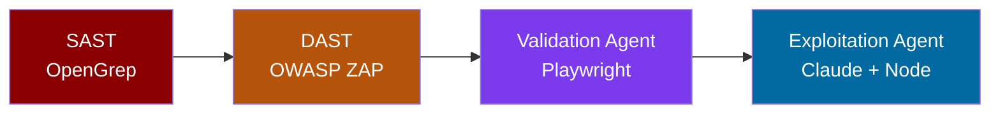

# Autonomous Vulnerability Research Pipeline

A four-stage security pipeline that bridges the gap between static analysis and dynamic testing using AI agents. SAST raises the lead, DAST shows where standard scanning stops, and agents close the gap by reading source code, authenticating, crafting payloads, and confirming exploitation in a real browser.

Built as a working demo for an OWASP presentation on autonomous vulnerability validation.

## How It Works



**Stage 1 — SAST (OpenGrep):** Custom rules scan the source and flag five potential vulnerabilities. These are leads, not confirmed bugs.

**Stage 2 — DAST (OWASP ZAP):** Three scan tiers (no auth, authenticated, agent-fed routes) show what a standard dynamic scan can and cannot reach.

**Stage 3 — Validation Agent (Node + Playwright):** Reads the SAST finding, resolves the route and parameter from source code, extracts credentials from the seed file, authenticates in a headless browser, delivers the payload, and confirms execution against a negative control.

**Stage 4 — Exploitation Agent (Node + Claude):** For filtered endpoints, sends the handler source to Claude for a defensive code review. Claude classifies the weakness type. The agent's own code translates that classification into bypass payloads, delivers them authenticated, and confirms the leak.

## Target Application

VulnTarget is a deliberately vulnerable Node/Express bug-reporting portal with six seeded weaknesses. Run it locally only.

| Vuln | Route | SAST | Standard DAST | Agent Needed |
|------|-------|------|---------------|--------------|
| Reflected XSS | `GET /search?q=` | Found | Missed (hidden route) | Yes |
| Stored XSS | Comments / profile name | Missed | Found | No |
| SQL Injection | `GET /filter?status=` | Found | Found | No |
| HTML Injection | `GET /preview?html=` | Found | Missed (hidden route) | Yes |
| Path Traversal | `GET /attachment?file=` | Found | Found | No |
| Path Traversal (filtered) | `GET /download?file=` | Found | Missed (filter blocks fuzz) | Yes |

## Quick Start

```bash
cp .env.example .env
# Add your ANTHROPIC_API_KEY to .env
docker compose up --build
```

Open http://localhost:3000, log in as `alice / password123`.

## Running the Pipeline

```bash
# Stage 1: SAST
docker compose run --rm scanner

# Stage 2: DAST (authenticated tier)
docker compose run --rm zap zap.sh -cmd -autorun /zap/wrk/plan-2-auth.yaml

# Stage 3: Validate XSS (agent + Playwright)
docker compose run --rm agent

# Stage 4: Exploit filtered traversal (agent + Claude)
docker compose run --rm --entrypoint node agent exploit-traversal.js
```

## Output

| Stage | Produces |
|-------|----------|
| SAST | `out/findings.json` |
| DAST | `zap/zap-out/*.html`, `zap/zap-out/*.json` |
| XSS Agent | `agent/poc/poc.md`, `agent/poc/poc.json` |
| Traversal Agent | `agent/poc/poc-traversal.md`, `agent/poc/poc-traversal.json` |

## Key Design Decisions

**Source-aware agents:** The agents read the application source code alongside the SAST finding. This lets them resolve hidden routes, extract auth credentials from seed data, and understand filter logic that a standard scanner never sees.

**LLM does review, code does exploitation:** The traversal agent asks Claude to classify the filter weakness defensively. The agent's own code builds the actual payloads. This keeps the LLM in an advisory role while the deterministic code handles execution.

**Negative controls:** Every proof is validated against a clean input to confirm the vulnerability is real, not a false positive.

## Demo Accounts

| Username | Password | Role |
|----------|----------|------|
| alice | password123 | engineer |
| bob | password123 | engineer |
| admin | admin123 | admin |